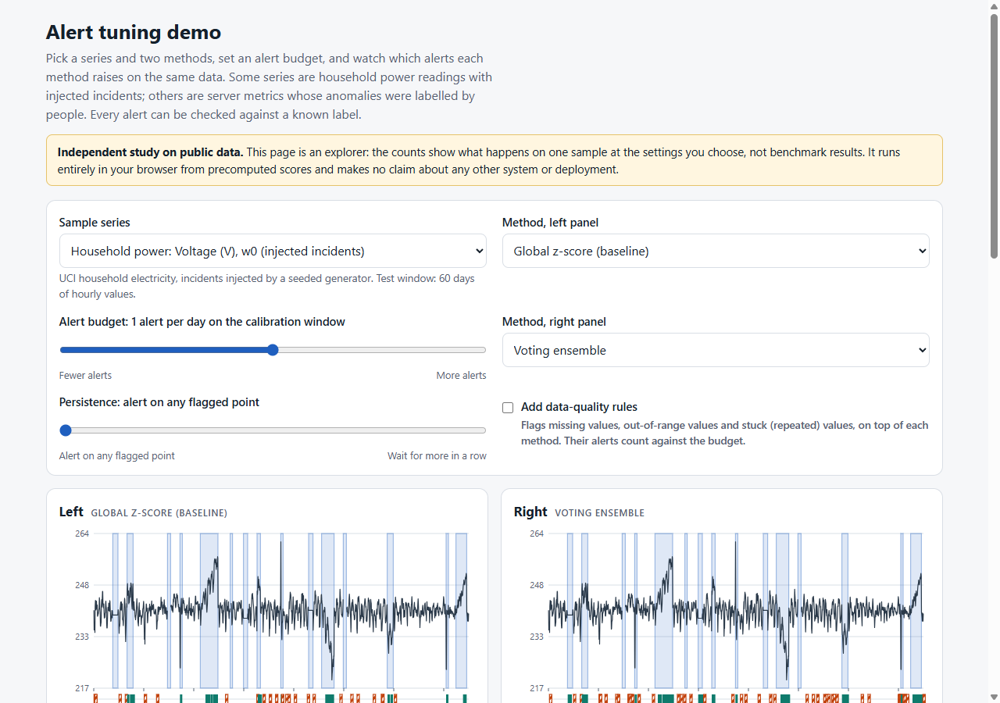
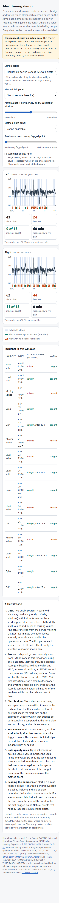
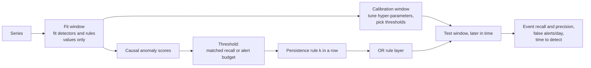
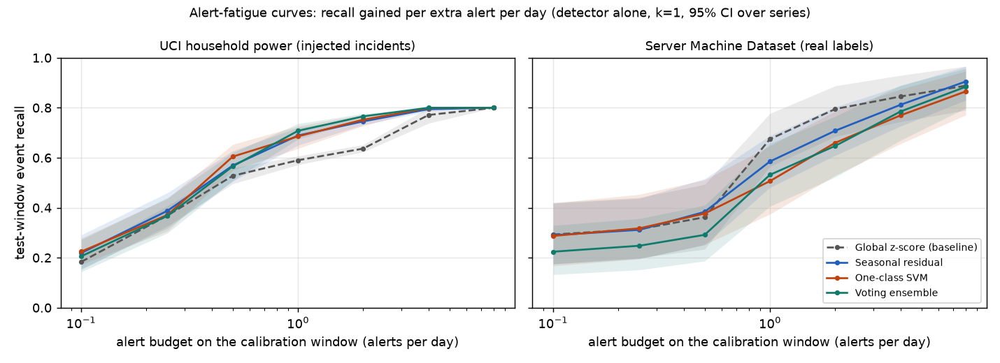

# Anomaly Detection for Data Quality and Monitoring: what reduces false alerts, and what does not

[](https://creativecommons.org/licenses/by-nc-nd/4.0/)
[](https://github.com/Janeferdinant/anomaly-detection-monitoring/actions/workflows/ci.yml)

> **Independent study on public data.** On injected anomalies in household-power series, the best detector alone cuts false alerts by 77% [-83%, -67%] against a global z-score at matched recall (Verified, run 2026-10-14, seeds 0, 1, 2, 3, 4). On real expert-labelled server data no detector is distinguishable from the z-score (-24% [-69%, +200%]), and adding the data-quality rule layer raises about 7 false alerts a day. The study makes no claim about any other system or deployment.

## Summary

Twelve detectors (global z-score baseline, rolling median/MAD, seasonal residual, EWMA chart, seasonal+EWMA, robust STL, Isolation Forest, local outlier factor, one-class SVM, PCA, autoencoder, voting ensemble) and a data-quality rule layer, compared on two datasets at the same event recall and at the same alert budget. All numbers are test-window results of the run dated 2026-10-14; intervals are 95% bootstrap intervals over series (UCI: 12 series, each averaged over 5 injection seeds; SMD: 22 machines for matched recall). The best method is the one with the lowest false alerts per day on the **calibration** windows, so the test numbers are not selected on test data.

| Dataset (labels) | Setting | Best method (chosen on calibration windows) | Test false alerts/day | Test event recall | Change in false alerts vs global z-score |
|---|---|---|---|---|---|
| UCI household power (**injected** incidents) | detector alone, calibration recall target 0.65 | EWMA control chart | 0.41 [0.27, 0.56] | 0.64 [0.62, 0.67] | **-77%** [-83%, -67%] (50 of 60 units matched) |
| UCI household power (**injected**) | + rule layer (missing, range, stuck), target 0.80 | global z-score (no method beats it) | 0.05 [0.02, 0.09] | 0.78 [0.74, 0.81] | every method has more false alerts (lowest: EWMA +21% [-51%, +242%]) |
| Server Machine Dataset (**real**, expert labels) | detector alone, target 0.65 | one-class SVM | 1.98 [0.88, 3.39] | 0.55 [0.40, 0.69] | -24% [-69%, +200%] (not distinguishable from 0; 20 of 22 machines matched) |
| Server Machine Dataset (**real**) | + rule layer, target 0.65 | global z-score (no method beats it) | 7.44 [3.64, 12.69] | 0.89 [0.83, 0.95] | every method within about -5% to +9%, intervals include 0 |

**What changed on real data.** The earlier negative finding holds and gets stronger: once a rule layer is added, no detector reduces false alerts against a z-score on either dataset. The earlier positive finding does **not** carry over: on injected incidents, seasonal and EWMA detectors cut false alerts by 60 to 80% at matched recall, but on real labelled anomalies no detector is reliably better than a global z-score, and at one alert per day the z-score has the highest recall (0.67 vs 0.36 to 0.60). The rule layer, tuned on injected sensor faults, raises about 7 false alerts a day on server metrics (details below).

## Overview

A small, tested toolkit for monitoring sensor and data-pipeline signals: a naive z-score baseline, eleven alternative detectors, a data-quality rule layer, an alert-suppression (persistence) rule, an online detector that processes one point at a time, and a command line `monitor stream <csv>`. Detectors are tuned only on a calibration window and compared on a later test window at matched recall and at fixed alert budgets, with operations-style metrics (event precision and recall, false alerts per day, time to detect, alert-fatigue curves, rule-layer ablation). An interactive demo lets you switch methods and move an alert-budget slider on both datasets.

## Demo

`docs/index.html` is a static page that runs in the browser from precomputed scores (no server, nothing fetched at load). Open the file locally, or serve the folder with `python -m http.server --directory docs`. It is not published anywhere. It shows six household-power series and three server machines, a method switcher for each of two side-by-side panels, an alert-budget slider, a persistence slider and a data-quality-rules switch, with true and false alerts and a per-incident caught/missed table. It shows counts for one sample at the chosen settings, not benchmark results.

| Desktop (1280 px) | Phone (390 px) |
|---|---|
|  |  |

## Problem statement

Monitoring systems drown people in alerts. Every false positive costs attention and erodes trust, but a detector tuned to be quiet can miss real incidents. A fair claim of "fewer false positives" therefore has to hold at the same recall (or at the same alert load). This project asks: on public data with labelled incidents, how many false alerts does each method raise at the same event recall, how much recall does each extra alert per day buy, how long does detection take, and what do the rule layer and the persistence rule buy or cost, on injected and on real anomalies?

## Approach



| Method | Idea |
|---|---|
| Global z-score (baseline) | `abs(x - mean) / std`, mean and std from the fit window |
| Rolling median/MAD | robust z-score against the trailing median and MAD |
| Seasonal residual | residual from the median of the same time of day over the previous days, scaled by a trailing robust scale |
| EWMA control chart | exponentially weighted moving average of the seasonal residual, for small sustained shifts |
| Seasonal + EWMA ("combo") | larger of the two, each divided by its fit-window 99th percentile |
| Robust STL residual | robust STL (statsmodels) seasonal profile from the fit window plus a causal trailing-median trend (two-sided STL trend would look into the future) |
| Isolation Forest, LOF, one-class SVM, PCA, autoencoder | scikit-learn models on causal window features of the per-channel seasonal residuals; PCA score is the squared reconstruction error, the autoencoder is a small dense network (scikit-learn MLP, CPU, `in-h-b-h-in`) |
| Voting ensemble | a point is flagged when at least `m` of five members (seasonal, EWMA, Isolation Forest, PCA, LOF) exceed their own scaled threshold; persistence is applied afterwards like for any method |
| Data-quality rules | missing values, range check (robust quantile bounds widened by a margin), stuck-value check (run length from natural repeats, switched off for channels that are mostly flat) |
| Persistence rule | raise an alert only after `k` consecutive flagged points (causal) |

For multi-metric series (SMD) the univariate methods run on every metric and alert on the largest normalised metric score; the learned models consume all metrics at once.

Protocol and rules that keep the comparison honest:

* **Three windows per series.** Detectors and rules are fitted on the fit window (values only, no labels). Hyper-parameters (small grids, 2 to 4 settings per method, plus the rule layer) are chosen on the **calibration window only**: first the share of units that cannot reach the target recall, then the mean calibration false alerts per day. The test window is never scored during tuning (a test replaces the test window and checks that the chosen settings do not change).
* **Matched recall.** The threshold is the highest one whose calibration event recall reaches a target (0.50, 0.65, 0.80). Comparisons use only units where both the method and the baseline reached it.
* **Alert budget.** The threshold is the lowest one that keeps all alerts on the calibration window within a budget of alerts per day (0.1 to 8); no labels are used. Test recall against budget is the alert-fatigue curve.
* **Operations metrics.** Event recall (a labelled event is caught if any flagged point falls inside it), event precision (share of alerts that overlap an event), false alerts per day, and time to detect (minutes from event start to first flagged point, median over caught events).
* **No leakage.** All scores are causal (tests change the future and compare), thresholds use calibration labels only, tests check that replacing the test window cannot change any calibration output.
* **Pre-registered primary comparison:** detector (alone, and with the rule layer) against the z-score at matched calibration recall, k=1; 0.80 on UCI (unchanged from the first run) and 0.65 on SMD (chosen from calibration-window diagnostics only). Everything else is secondary and reported whatever the outcome.

## Data

* **UCI Individual Household Electric Power Consumption** (Hebrail and Berard, 2006, [doi:10.24432/C58K54](https://doi.org/10.24432/C58K54), CC BY 4.0). Hourly means of four channels, 12 gap-free 120-day windows. The dataset has no incident labels, so a seeded generator (`inject.py`) injects spikes, level shifts, drifts, stuck values and missing bursts (15 per 60-day half). **Labels are synthetic.** Seeds 0 to 4. First 60 days: fit and calibration; last 60 days: test.
* **Server Machine Dataset (SMD)** (Su et al., KDD 2019; [github.com/NetManAIOps/OmniAnomaly](https://github.com/NetManAIOps/OmniAnomaly), MIT, pinned commit). 28 machines, 38 metrics at one-minute resolution; five weeks of unlabelled training data and five weeks of test data whose anomaly intervals were labelled by domain experts. **Labels are real and human-made.** Here: five-minute means (a bin is anomalous if any minute is), metrics constant in the training data dropped (192 over 28 machines), fit window = training part, calibration window = first half of the labelled part, test window = second half. 22 machines have at least two calibration events and one test event (129 calibration and 158 test events) and enter the matched-recall protocol; all 28 enter the alert-budget protocol.
* **Download at run time, never committed.** `scripts/download_data.py` (UCI, SHA-256 checked) and `scripts/download_smd.py` (SMD, 84 files, SHA-256 per file in `src/anomaly_monitoring/smd_manifest.json`). `data/raw/` is git-ignored. The demo embeds small modified excerpts of both datasets (see `THIRD_PARTY_NOTICES.md`).
* **Benchmarks checked and not used:** NAB (license is currently MIT; not used for scope reasons, listed under future scope) and SKAB (GPL-3.0, short lab runs without a daily cycle). Details in `THIRD_PARTY_NOTICES.md`.

## Results

All numbers come from committed run logs: [`docs/runs/2026-10-14-uci-benchmark.md`](docs/runs/2026-10-14-uci-benchmark.md) and [`docs/runs/2026-10-14-smd-benchmark.md`](docs/runs/2026-10-14-smd-benchmark.md) (full tables, tuning logs, settings, hardware), raw rows in `results/benchmark_*/`, plus the first run [`docs/runs/2026-10-14-evaluation.md`](docs/runs/2026-10-14-evaluation.md) (kept unchanged). Status for every number below: `Verified (run 2026-10-14)`.



*Test recall against the alert budget (detector alone, k=1). On injected incidents (left) the learned and seasonal methods gain recall faster than the z-score; on real labels (right) the curves overlap within their intervals and the z-score is on top at one alert per day.*

### Does the rule layer erase the detector advantage? (pre-registered primary comparison)

Change in test false alerts per day against the z-score, pooled over series, 95% bootstrap interval; negative is better. Detector + rule layer, k=1.

| Method | UCI injected, target 0.80 (60 of 60 units) | SMD real, target 0.65 (22 of 22 machines) |
|---|---|---|
| Rolling median/MAD | +310% [+112, +1047] | +0% [-3, +3] |
| Seasonal residual | +178% [+37, +636] | +1% [-2, +8] |
| EWMA control chart | +21% [-51, +242] | -5% [-19, +5] |
| Seasonal + EWMA | +44% [-49, +323] | -2% [-9, +4] |
| Robust STL residual | +419% [+207, +1274] | +1% [-1, +4] |
| Isolation Forest | +124% [0, +584] | +9% [0, +22] |
| Local outlier factor | +1001% [+545, +2999] | -1% [-19, +20] |
| One-class SVM | +350% [+114, +1359] | -1% [-10, +10] |
| PCA | +679% [+286, +2290] | -3% [-17, +9] |
| Autoencoder | +902% [+399, +3202] | -2% [-15, +10] |
| Voting ensemble | +171% [+23, +731] | +1% [-10, +16] |
| z-score + rules, false alerts/day (recall) | 0.05 (0.78) | 7.44 (0.89) |

* **UCI (injected):** the earlier result holds. A z-score plus missing/stuck rules is already very quiet (0.05 false alerts a day) and no detector beats it. Ablation: the missing and stuck rules do the work (either alone: 0.17 false alerts/day, recall 0.71; both: 0.05, 0.78); the range rule alone changes nothing because injected faults stay inside the widened range.
* **SMD (real):** the same conclusion for a different reason. The rule layer is the dominant source of alerts: z-score alone 2.56 false alerts/day at recall 0.69, with rules 7.44 at 0.89. The range rule alone gives 6.68 at 0.89, the stuck rule 3.45 at 0.70, and missing values never occur. Server metrics drift between regimes, so "outside the training range" is both a good detector (recall 0.89) and a noisy one, and every detector added on top is within a few percent of the z-score because the rule layer's alerts dominate. The rule settings were tuned on calibration windows like everything else (the chosen setting is in the run log); the selection criterion prefers settings that can reach the target recall, which also favours the noisy ones.

### Detector alone, at matched calibration recall

| Dataset, target | What the intervals say |
|---|---|
| UCI injected, 0.65 (50 of 60 units matched) | Fewer false alerts than the z-score: EWMA -77% [-83, -67], one-class SVM -68% [-79, -49], Isolation Forest -67% [-76, -52], seasonal+EWMA -66% [-75, -52], voting ensemble -62% [-72, -45], seasonal -63% [-73, -45], robust STL -38% [-54, -13]. No clear change: rolling MAD, LOF, PCA, autoencoder. Test recall 0.60 to 0.72 vs 0.62 to 0.64 for the z-score (recall is matched on calibration, not exactly on test). |
| UCI injected, 0.50 | No reduction; seasonal, STL, LOF, PCA, autoencoder are worse (+186% to +816%): at low recall targets the large injected incidents are easy for a global z-score. |
| SMD real, 0.65 (20 of 22 machines) | No method has an interval that excludes 0 on the good side; LOF is worse (+199% [+26, +1292]). Point estimates range from -46% (seasonal+EWMA) to +51% (EWMA) with 2 to 6 machines better and 7 to 11 worse. |
| SMD real, 0.50 and 0.80 | Same picture; at 0.80 Isolation Forest (+89% [+14, +304]) and LOF (+168% [+23, +648]) are worse than the z-score. |

### Alert budget and alert fatigue (no labels in the threshold)

Test event recall at one alert per day on the calibration window (detector alone, k=1; mean over series, 95% CI):

| Method | UCI injected | SMD real |
|---|---|---|
| Global z-score | 0.59 [0.57, 0.61] | 0.67 [0.57, 0.78] |
| Seasonal residual | 0.69 [0.65, 0.72] | 0.59 [0.48, 0.69] |
| EWMA control chart | 0.73 [0.71, 0.75] | 0.36 [0.24, 0.48] |
| One-class SVM | 0.69 [0.64, 0.73] | 0.51 [0.37, 0.65] |
| Voting ensemble | 0.71 [0.67, 0.74] | 0.53 [0.41, 0.66] |

False alerts per day, event precision and median time to detect at three budgets are in the run logs. On real data time to detect is mostly 0 to 15 minutes at one alert per day (the z-score 0, EWMA 17.5, Isolation Forest 12.5 minutes at the SMD median) because alerts that are already running when an event starts count as delay 0. **Caveat:** the budget counts alert segments, so a threshold low enough to keep a detector flagged for a long stretch counts as one alert; the column `flagged_share` in `results/benchmark_*/budget.csv.gz` shows the share of test points flagged, and the highest budgets (4 to 8 per day) should be read with it.

### Persistence rule

At matched recall (threshold re-calibrated for each k) persistence is not a free win. On SMD the z-score reaches the 0.65 target on 0.91, 0.73 and 0.50 of machines for k=1, 2, 3, and false alerts per day do not fall (2.56, 4.83, 3.47). On UCI at target 0.80 the seasonal residual reaches the target on 0.98, 0.23 and 0.02 of units for k=1, 2, 3 (false alerts 1.99, 1.06, 0.67 on the units that reach it) and delays detection by one to three hours. See the run logs for every method.

### History: the first run (kept) and what the re-run changed

| Quantity (UCI, injected) | First run 2026-10-14 (6 detectors, default parameters) | This run (12 detectors, parameters tuned on calibration windows) |
|---|---|---|
| Primary: detector + rules, target 0.80, EWMA vs z-score | -5% [-61, +195] | +21% [-51, +242] |
| same, seasonal residual | +78% [-44, +442] | +178% [+37, +636] |
| same, rolling median/MAD | +310% [+112, +1047] | +310% [+112, +1047] |
| Detector alone, target 0.65, EWMA | -79% [-84, -72] | -77% [-83, -67] |
| Detector alone, target 0.65, seasonal residual | -59% [-70, -40] | -63% [-73, -45] |

The first run's `results/results.csv` is reproduced byte for byte by the refactored code (`python scripts/run_evaluation.py`, 8640 rows, maximum absolute difference 0). The differences above come from tuning on calibration windows, not from changed code. Point-adjusted scoring inflates recall (first run: 0.76 vs 0.32 raw point recall) and is not used for the new tables.

### Tests and checks

| Check | Result |
|---|---|
| `pytest` | 176 passed (detectors, rules, metrics, alerting, injection, evaluation, no-leakage, streaming equivalence, CLI, benchmark, SMD loader) |
| `ruff check .`, `mypy` | clean |
| Online monitor vs batch detector | identical scores and flags for z-score, rolling MAD, seasonal, EWMA, with persistence and rules (`tests/test_streaming.py`) |

## Streaming and command line

`anomaly_monitoring.streaming.OnlineMonitor` processes one value at a time with bounded state (a fixed-length buffer of past values and residuals) and returns score, flag and whether a new alert started. It supports the z-score, rolling MAD, seasonal and EWMA detectors, the persistence rule and the rule layer, and equals the batch pipeline.

```bash
python scripts/make_sample_csv.py
monitor stream data/processed/sample_voltage.csv --time-column timestamp --fit-points 1440 --budget 1 --persistence 2 --rules
```

The command fits on the first `--fit-points` values, picks the threshold that keeps the fit-window alert rate within `--budget` alerts per day (or takes `--threshold`), replays every row one at a time and prints a line per alert, then a summary (`alerts after the fit window: 45 (0.75 per day over 60.0 days)` for the sample above). `monitor stream --help` lists the options.

## Tech stack

Python 3.11, NumPy, pandas, scikit-learn, statsmodels (STL), matplotlib (figure only), pytest, ruff, mypy. The demo is plain HTML, CSS and JavaScript with inline SVG. CI: GitHub Actions runs ruff, mypy and the fast tests (never the long experiments).

## Getting started

Prerequisites: Python 3.11, git, about 1.5 GB of disk (virtual environment, 20 MB and 460 MB downloads, unpacked data) and a network connection for the one-time downloads. The SMD benchmark takes about 15 to 20 minutes on 8 CPU workers, the UCI benchmark about 4 to 6 minutes, the first-run evaluation about 8 minutes.

```bash
git clone https://github.com/Janeferdinant/anomaly-detection-monitoring.git
cd anomaly-detection-monitoring
python -m venv .venv
source .venv/bin/activate            # Windows: .venv\Scripts\activate
pip install -r requirements-dev.txt
pip install -e . --no-deps
ruff check . && mypy && pytest -q
python scripts/download_data.py
python scripts/download_smd.py
python scripts/run_benchmark.py --dataset uci
python scripts/run_benchmark.py --dataset smd
python scripts/make_figure.py
python scripts/build_demo.py
python scripts/run_evaluation.py      # optional: the first run (6 detectors), about 8 minutes
```

`make install lint typecheck test data eval-benchmark demo` does the same in steps. Expected output: `pytest` ends with `176 passed`; the downloads print `Checksum OK`; each benchmark ends with `done in ... min; wrote results/benchmark_<dataset>` and writes `docs/runs/<date>-<dataset>-benchmark.md`; `build_demo.py` prints `wrote docs/index.html`. Results are deterministic for the same seeds; only dates and runtimes change. `python scripts/run_benchmark.py --dataset smd --smoke` runs 3 machines with one seed as a quick check.

## Project structure

```
src/anomaly_monitoring/
  detectors.py   twelve detectors, hyper-parameter grids, multi-metric wrappers
  rules.py       missing / range / stuck checks (single and multi-metric)
  alerting.py    persistence rule, matched-recall and alert-budget thresholds
  metrics.py     point, point-adjusted, event-level metrics, time to detect
  benchmark.py   windows, tuning on calibration windows, both protocols, ablation
  opsreport.py   summary tables with bootstrap intervals
  streaming.py   online monitor (one point at a time)
  cli.py         monitor stream <csv>
  smd.py         Server Machine Dataset download (checksummed) and loader
  data.py, inject.py, evaluate.py, report.py   UCI loader, incident generator, first-run protocol
scripts/         download_data.py, download_smd.py, run_benchmark.py, run_evaluation.py, build_demo.py, make_figure.py, make_sample_csv.py
tests/           176 tests
docs/            index.html (demo), img/, runs/ (dated run logs)
results/         results.csv, summary.json (first run); benchmark_uci/, benchmark_smd/ (new runs)
```

## Real-world applications

Alert tuning for sensor and IoT monitoring, data-pipeline freshness and quality monitors, server and service metric monitoring, and energy-consumption monitoring. The rule layer mirrors checks that data-quality tools run on tables (null rate, value range, frozen values), the persistence rule mirrors "for 5 minutes" conditions in alerting systems, and the alert budget mirrors paging limits for on-call teams.

## Limitations

* **Injected labels are easy; real labels are noisy.** On UCI the incidents are synthetic, large and cleanly bounded, and natural events count as false alerts. SMD labels are real, but interval boundaries are human judgements, and many labelled intervals are short or adjacent after five-minute binning.
* **Small event counts.** SMD has 129 calibration and 158 test events over 22 machines (a few per machine per window), so thresholds are noisy, test recall is not exactly matched, and intervals are wide. Six machines have no calibration event and enter only the alert-budget protocol.
* **Two datasets, one household and 28 machines of one provider.** NAB and other benchmarks are not used; results may not transfer.
* **The learned models see residual features, not raw values,** and have small hyper-parameter grids (2 to 4 settings). Raw-input variants, longer windows or deeper networks could change the ranking. The autoencoder is a small scikit-learn MLP, not a sequence model.
* **Multi-metric aggregation is simple** (largest normalised metric score for univariate methods). 192 training-constant metrics were dropped; the stuck rule is switched off for mostly flat metrics.
* **Event-level scoring is generous for long events** (one flagged point catches the event), and the alert budget counts alert segments, so very low thresholds produce few, very long alerts (see `flagged_share`).
* **Rule-layer settings and the SMD primary recall target were chosen from calibration windows,** with a criterion that favours reaching the target recall; other criteria could favour a quieter rule layer.
* Stochastic models are tuned with seed 0 and the UCI settings on each unit's own calibration window, the same seeds the evaluation uses (calibration windows only, no test data).
* Offline evaluation: the streaming monitor is verified for equality with the batch code but has not been run against a live system, and there is no human feedback loop. Streaming supports four detectors, not the learned models.
* The first full SMD and UCI runs were discarded after a bug in the one-class SVM score (missing values outranked normal points) was found and fixed; the re-run is the reported one (details in the run logs). The earlier first-run stuck-rule fix is described in `docs/runs/2026-10-14-evaluation.md`.

## Future scope

Add NAB (MIT) and other public benchmarks with real labels; raw-value and longer-context variants of the learned models and a sequence autoencoder; per-metric learned rule limits and rule layers that adapt to regime changes; alert grouping across correlated metrics and incident-level scoring; online evaluation with learned detectors and delay-aware metrics; a live replay against a metrics store.

## Credits & citation

Data: Hebrail, G. and Berard, A. (2006). *Individual Household Electric Power Consumption* [Dataset]. UCI Machine Learning Repository. https://doi.org/10.24432/C58K54 (CC BY 4.0, modified as described in `THIRD_PARTY_NOTICES.md`). Su, Y., Zhao, Y., Niu, C., Liu, R., Sun, W. and Pei, D. (2019). Robust Anomaly Detection for Multivariate Time Series through Stochastic Recurrent Neural Network. *KDD 2019*. Server Machine Dataset, MIT licence, copyright 2021 NetManAIOps-SMD (modified as described in `THIRD_PARTY_NOTICES.md`).
Methods: Isolation Forest (Liu, Ting and Zhou, 2008), LOF (Breunig et al., 2000), one-class SVM (Scholkopf et al., 2001), STL (Cleveland et al., 1990), EWMA control charts (Roberts, 1959), point-adjusted scoring (Xu et al., 2018). Models come from scikit-learn and statsmodels.

## License

Original work © Jane Rose Ferdinant, licensed CC BY-NC-ND 4.0. Third-party components retain their own licenses; see THIRD_PARTY_NOTICES.md.

## Author

Jane Rose Ferdinant, Assistant Professor, AI and ML.
Portfolio: https://janeferdinant.vercel.app
LinkedIn: https://www.linkedin.com/in/janerosenf/
